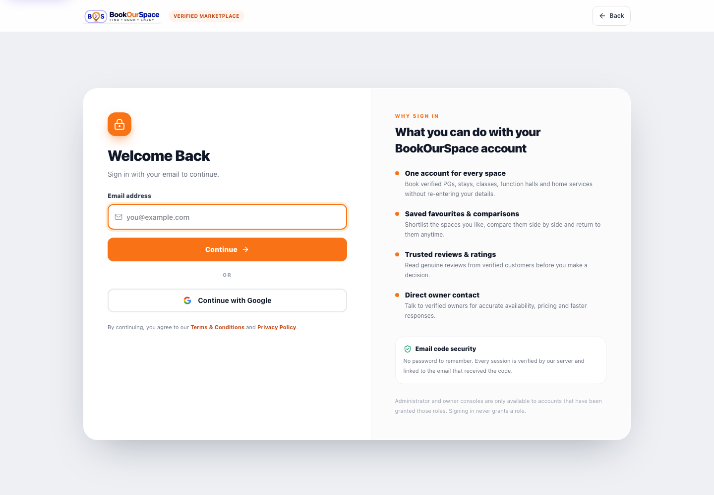

# Email OTP sign-in (Supabase Auth + Resend)

BookOurSpace supports passwordless sign-in with a 6-digit email code. Google
OAuth remains available unless an administrator disables it.

The code is generated by **Supabase Auth**, delivered by **Resend**, and
verified by **Supabase Auth**. If the server has no Resend key but the browser
has a Supabase client, the login screen falls back to Supabase's own email
provider (`signInWithOtp`); the identity and session are still verified by
Supabase and re-verified by the API. The BookOurSpace API never returns the code to
the browser and never invents an identity: after verification it independently
re-verifies the Supabase access token, then mints its normal HMAC application
session.



## Flow

1. The visitor enters an email address on `#login`.
2. `POST /api/auth/email-otp/request`
   - validates the address, applies a 60-second resend cooldown and hourly limits,
   - creates the Supabase Auth user with `email_confirm: true` if needed,
   - calls Supabase Admin `generate_link` (`type: magiclink`),
   - sends the returned `email_otp` through Resend.
3. The visitor types the code.
4. `POST /api/auth/email-otp/verify`
   - calls Supabase Auth `/auth/v1/verify`,
   - returns the Supabase `access_token` and `refresh_token` once.
5. The browser installs the Supabase session and calls
   `POST /api/auth/supabase/authenticate`.
6. The API re-verifies the access token with Supabase Auth, accepts the `email`
   or `google` provider, provisions the profile if needed and returns the
   server-signed application session.
7. `/api/auth/me` resolves the durable profile and current role on every reload.

## Required configuration

Server-only (never `VITE_*`):

```dotenv
VITE_SUPABASE_URL="https://<project-ref>.supabase.co"
VITE_SUPABASE_PUBLISHABLE_KEY="sb_publishable_..."
VITE_SUPABASE_PROJECT_ID="<project-ref>"
VITE_SUPABASE_DEVELOPMENT_PROJECT_ID="<project-ref>"

SUPABASE_SECRET_KEY="sb_secret_..."        # Supabase Admin API
RESEND_API_KEY="re_..."                    # Resend API key
RESEND_FROM_EMAIL="BookOurSpace <login@your-verified-domain>"
RESEND_REPLY_TO="support@your-domain"      # optional
BOS_SUPPORT_EMAIL="support@your-domain"    # shown in the email footer
```

In Supabase:

1. **Authentication → Providers → Email** must be enabled (the default).
2. The service-role/secret key used by the API must be allowed to call the
   Auth Admin API.
3. You do **not** need to configure Supabase SMTP for the Resend flow: the
   server sends the code through Resend. Supabase only generates and verifies it.
4. Only if you rely on the **Supabase-native fallback** (no server Resend keys),
   configure Supabase SMTP and add `{{ .Token }}` to the Magic Link email
   template so the email contains the 6-digit code. Without that placeholder
   Supabase sends a link only and the code screen cannot be completed.

In Resend:

1. Verify the sending domain used by `RESEND_FROM_EMAIL`.
2. Create an API key with send permission and store it as `RESEND_API_KEY` in
   the server environment (for example Cloud Run secrets).
3. Keep the key out of every `VITE_*` variable and out of browser bundles.

## Administrator controls

`Admin console → App Settings & Audit → Sign-in & guest access` controls:

| Switch | Default | Effect |
| --- | --- | --- |
| Allow guest browsing | **off** | Shows “Explore Spaces as Guest” on the welcome and login screens. Guests cannot book, save or open a console. |
| Email one-time code sign-in | on | Shows the email form. Hidden when delivery is not configured. |
| Google sign-in | on | Shows “Continue with Google”. |

The server refuses to disable both account sign-in methods. Settings are
stored in the PostgreSQL `app_settings` module payload under `authAccess`. In
local development without PostgreSQL they fall back to
`BOS_AUTH_SETTINGS_FILE` (default `.bos-auth-settings.json`, gitignored).
`BOS_GUEST_LOGIN_ENABLED` and friends are only defaults when no administrator
setting exists.

Public read: `GET /api/auth/config` (guest flags only, never secrets).
Admin read/write: `GET`/`PUT /api/admin/auth-settings` (requires an admin
session; production resolves the durable profile role from PostgreSQL).

## Security properties

- The API response to `email-otp/request` never contains the code.
- Request responses do not reveal whether an account exists.
- Wrong and expired codes share one generic error.
- 60-second resend cooldown, per-email and per-IP hourly caps, and a
  verification-attempt cap.
- OTP verification is single-use (Supabase consumes the token).
- The application session is still minted only after the API re-verifies the
  Supabase access token and a confirmed email address.
- `authProvider` is `email` or `google`; every protected module accepts both
  verified providers, but none accepts an unverified client-supplied identity.
- The `/api/auth/google/authenticate` route keeps its historical Google-only
  contract; `/api/auth/supabase/authenticate` is the generic exchange.

## Local testing

The contract is covered by `tests/email-otp-auth.test.mjs` with a local fake
Supabase Auth/Resend server, so it does not send real email:

```bash
npx tsx --test tests/email-otp-auth.test.mjs
```

To test real delivery locally:

```bash
# .env.local (never commit)
SUPABASE_SECRET_KEY="sb_secret_..."
RESEND_API_KEY="re_..."
RESEND_FROM_EMAIL="BookOurSpace <login@your-verified-domain>"
npm run dev
# open http://localhost:5173/#login
```

If `GET /api/auth/config` reports `emailOtpConfigured: false`, check the server
log line `[email-otp] Email sign-in stays disabled until configured: missing …`
and add the named variables.

## Troubleshooting

| Symptom | Likely cause |
| --- | --- |
| `EMAIL_OTP_DELIVERY_UNAVAILABLE` | Supabase secret key, Resend key, or verified sender missing/invalid. Check server logs (secrets are redacted). |
| `EMAIL_OTP_NOT_CONFIGURED` | One of `SUPABASE_SECRET_KEY`, `RESEND_API_KEY`, `RESEND_FROM_EMAIL` is empty. The login screen uses Supabase's own email provider only when the browser has a Supabase client. |
| `EMAIL_OTP_INVALID` for a fresh code | The code expired, was reused, or the Supabase project differs from the one used to generate it. Request a new code. |
| `OTP_COOLDOWN` / `OTP_RATE_LIMITED` | Wait for the countdown or the hourly window. |
| Guest button missing | Guest browsing is off. Enable it in Admin console → App Settings. |
